# 🛡️ Warranty Claims Fraud Prediction

[](https://www.python.org/)
[](https://scikit-learn.org/)
[](https://imbalanced-learn.org/)
[](https://shap.readthedocs.io/)
[](LICENSE)

An end-to-end Machine Learning pipeline designed to detect and predict **fraudulent warranty claims** in consumer electronics (ACs & TVs). This project tackles severe **class imbalance (~9.8% fraud)** using **SMOTE**, engineers domain-specific risk ratios, benchmarks gradient boosting models (**XGBoost & LightGBM**), and leverages **Explainable AI (SHAP)** with **probability threshold optimization** to achieve up to **66.7% fraud detection recall**.

---

## 📌 Problem Overview & Business Impact

Warranty fraud causes manufacturers and insurance providers to lose millions annually. Detecting fraud early protects company margins while ensuring legitimate customer claims are approved swiftly.

- **Dataset**: 358 Records × 21 Original Features (Extended to 29 via Feature Engineering)
- **Target**: `Fraud` (1 = Fraudulent Claim, 0 = Genuine Claim)
- **Core Challenge**: High Class Imbalance — Fraud accounts for only **~9.8%** of total claims. A naive model predicting all claims as genuine achieves 90.2% accuracy but catches **0%** fraud.

---

## 🏗️ End-to-End Pipeline Architecture

```mermaid
graph LR
    A[Raw Claim Data] --> B[Exploratory Data Analysis]
    B --> C[Feature Engineering & Ratios]
    C --> D[ColumnTransformer Preprocessing]
    D --> E[SMOTE Resampling]
    E --> F[Model Training: XGBoost / LightGBM / RF]
    F --> G[5-Fold Stratified Cross-Validation]
    G --> H[Threshold Optimization 0.25]
    H --> I[SHAP Interpretability]
```



1. **Exploratory Data Analysis (EDA)**: Geographic clustering, customer profiles, product issue categories, call duration, and purchase channels.
2. **Domain-Specific Feature Engineering**:
   - `Total_Issues`: Aggregated component failures across AC & TV parts.
   - `Has_No_Issue`: Flag claims filed without hardware part failures.
   - `Claim_Per_Product_Age`: Ratio of claim cost relative to product lifespan.
   - `Claim_Per_Call_Duration`: Financial claim density per minute of customer care call.
   - `Is_Early_Claim`: Claims submitted within 45 days of purchase.
   - `Is_Short_Call`: Calls lasting under 2 minutes.
3. **Leakage-Free Preprocessing**: `ColumnTransformer` with `RobustScaler` (resistant to financial outliers) and `OneHotEncoder`.
4. **Class Imbalance Resolution**: `SMOTE` (Synthetic Minority Over-sampling Technique) applied strictly to training folds.
5. **Modern Gradient Boosters**: `XGBoost` & `LightGBM` alongside `Balanced Random Forest`.
6. **Cost-Sensitive Threshold Optimization**: Tuning the decision boundary from 0.50 down to 0.25 to maximize fraud capture without overwhelming investigators.
7. **Model Interpretability (Explainable AI)**: `SHAP (TreeExplainer)` to unpack black-box model decisions.

---

## 📊 Benchmark Results

### Test Set Comparison (Evaluating Beyond Accuracy)

| Model | Recall (Fraud Caught) | Precision | F1-Score | ROC-AUC | PR-AUC |
|---|:---:|:---:|:---:|:---:|:---:|
| **Logistic Regression (Baseline)** | 0.0% *(Missed all)* | 0.0% | 0.000 | 0.702 | 0.194 |
| **Decision Tree (Baseline)** | 33.3% | 33.3% | 0.333 | 0.676 | 0.255 |
| **Random Forest (Balanced)** | 44.4% | 25.0% | 0.320 | 0.675 | 0.188 |
| **LightGBM (Balanced)** | **44.4%** | 22.2% | 0.296 | 0.654 | 0.166 |
| **XGBoost (SMOTE + 0.25 Optimal Threshold)** | **66.7%** | 24.0% | **0.353** | **0.705** | 0.177 |

### 5-Fold Stratified Cross-Validation Summary
- **LightGBM (Balanced)**: Mean Recall = **45.7%** | Mean ROC-AUC = **0.667**
- **Random Forest (Balanced)**: Mean Recall = **31.4%** | Mean ROC-AUC = **0.706**
- **XGBoost (SMOTE)**: Mean Recall = **20.0%** | Mean ROC-AUC = **0.668**

---

## 🔍 Key Findings & SHAP Explainability

1. **Purchase Channel Risk**: Products bought directly from the **Manufacturer** exhibit the highest correlation with fraud according to SHAP feature importance.
2. **Service Center Outliers**: Specific service centers (e.g., Center 14) exhibit concentrated fraud clusters.
3. **Product Lifecycle**: High-value claims filed within the first 45 days (`Is_Early_Claim` and `Claim_Per_Product_Age`) strongly indicate fraudulent submissions.
4. **Threshold Impact**: In warranty fraud, a False Negative (missing fraud) is significantly more expensive than a False Positive (manual inspection). Lowering the threshold to **0.25** elevates fraud capture from **22.2% to 66.7%**.

---

## 📂 Repository Structure

```
├── warranty-claims-fraud-prediction.ipynb  # 🚀 Main Jupyter Notebook (EDA, ML & SHAP)
├── df_Clean.csv                            # 📊 Cleaned historical claims dataset
├── requirements.txt                        # 📦 Project dependencies
├── LICENSE                                 # 📜 MIT License
└── README.md                               # 📖 Documentation
```

---

## 🚀 Quickstart & Installation

### 1. Clone the repository
```bash
git clone https://github.com/roy-21/Warranty-Claims-Fraud-Prediction.git
cd Warranty-Claims-Fraud-Prediction
```

### 2. Install dependencies
```bash
pip install -r requirements.txt
```

### 3. Run the Jupyter Notebook
```bash
jupyter notebook warranty-claims-fraud-prediction.ipynb
```

*(Alternatively, run the standalone script directly in your terminal: `python advanced_fraud_detection.py`)*

---

## 📜 License
This project is licensed under the MIT License - see the [LICENSE](LICENSE) file for details.
